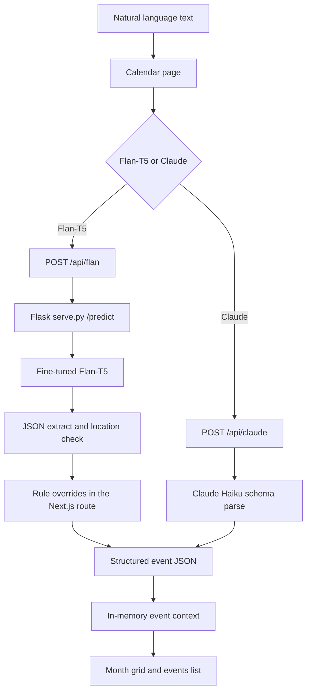

# CalendarAI

CalendarAI is a four-person team project. You type a sentence about something you need to schedule, and the app turns it into a structured event and draws it on a month calendar. The interface title is CalendarAI. The repository is the team's NLP calendar project.

The default path runs a fine-tuned Flan-T5-Base model behind a local Flask server, then applies hand-written rules for date, time, title, duration, location, and recurrence. A toggle on the calendar can send the same sentence to Claude instead. Events stay in React state for the current browser session.

This repository started from the Untitled UI Next.js starter kit. The product code is the calendar, the two API routes, the Python model servers, the training notebook, and the data and test files described below. Attribution for the starter kit is in [Credits](#credits).

## Problem and motivation

A calendar stores a title, a date, a start, an end, a duration, a place, and a repeat rule. People usually describe the same thing in a sentence: "dentist on March 5th at 2:30 PM for 45 minutes at Bright Smile Dental Clinic." The project is an attempt to do that conversion with a small sequence-to-sequence model, then clean the fields with rules so the month view has something it can render.

The saved training run shows why the rules exist. After fine-tuning, the model often copied a plausible title and time, and it often failed to emit valid JSON or the date that was actually in the sentence. The app therefore does not trust the model output as the final event.

## Key features

- A month calendar at `/calendar` with a text box. Submitting a sentence calls `POST /api/flan` or, if the toggle is on, `POST /api/claude`.
- The Flan path calls a local Flask server (`serve.py` on port 8000), parses whatever JSON it can find in the model text, and then overwrites fields with rules in [`src/app/api/flan/route.ts`](src/app/api/flan/route.ts).
- The calendar stores `start_time` and `end_time`. If the sentence has a start and a duration but no end, the route computes the end.
- Event pills can be expanded. The expanded pill shows start, end, duration, and location. Daily, weekly, and monthly events are copied onto later days in the visible month. Past days are skipped. Biweekly, yearly, and custom repeats are stored and not expanded.
- `/events` lists the same in-memory events, grouped by month. The home screen at `/` and `/home` links to Calendar and Events.
- A Jest unit file mocks the model server. A second file calls the real Flask server. Neither file is the Python field-accuracy script.

A few controls are present and not wired up. The search box, the search button, and the "Month view" button have no handlers. The sidebar links to `/settings`, and there is no settings page. The sidebar footer is hardcoded placeholder text, not a signed-in user.

## Example interactions

There are no interface screenshots in the repo. `public/` contains only `favicon.ico`. Captures worth adding, from a running app:

1. `/` with the CalendarAI heading and the Calendar and Events cards.
2. `/calendar` before any event, including the text box, Add event, and the Flan-T5 / Claude toggle.
3. `/calendar` after a sentence that includes a place and a duration, with the event pill expanded so Start, End, Duration, and Location are visible.
4. `/events` in that same browser session, so it is obvious the event survived the navigation.
5. A weekly sentence such as "Team meeting every Monday at 10am for 1 hour", showing the extra days on the month grid.
6. The calendar error state with `serve.py` stopped.

The examples below are copied from the dataset, the training notebook output, or the current route. They are not mockups.

### Labeled training pair

From [`dataset.jsonl`](dataset.jsonl). This is the generator's label, not a model prediction. The sentence never says 2025. The label still has `2025-03-05`.

Input:

```text
Can you add a dentist appointment on March 5th at 2:30 PM for about 45 minutes at Bright Smile Dental Clinic?
```

Label:

```json
{
  "title": "Dentist Appointment",
  "date": "2025-03-05",
  "time": "14:30",
  "duration_minutes": 45,
  "location": "Bright Smile Dental Clinic",
  "recurrence": "none"
}
```

A second row shows a missing date and a shortened place name. The input says "The Green Table restaurant". The label says "The Green Table".

```text
Let's have a team lunch every Friday at noon at The Green Table restaurant, lasting about an hour and a half
```

```json
{
  "title": "Team Lunch",
  "date": null,
  "time": "12:00",
  "duration_minutes": 90,
  "location": "The Green Table",
  "recurrence": "weekly"
}
```

### Recorded model output

These two generations are stored in [`notebooks/FlanT5_Calendar_Event_Parser.ipynb`](notebooks/FlanT5_Calendar_Event_Parser.ipynb) from the fine-tune that is checked in. The model text is not wrapped as a JSON object.

Input:

```text
Let's schedule a quarterly business review every three months starting March 15th, 2025 at 2pm in the large conference room on the 4th floor, lasting about two and a half hours
```

Expected duration was 150 minutes. The model returned 90, and it did get the date, time, title, location, and `custom` recurrence:

```text
"date": "2025-03-15", "duration_minutes": 90, "location": "Large Conference Room, 4th Floor", "recurrence": "custom", "time": "14:00", "title": "Quarterly Business Review"
```

Input:

```text
Meeting with Sarah on June 5th 2025 at 1pm for 30 minutes in the library
```

Model output:

```text
"date": "2025-05-03-15", "duration_minutes": 90, "location": "Large Library", "recurrence": "recurrence": "recurrence": "recurrence": "recurrence": "recurrence": "recurrence
```

The date is not a real calendar date, the duration and location are wrong, and the recurrence field is repeated until the string cuts off.

### What the Flan route returns now

[`src/app/api/flan/route.ts`](src/app/api/flan/route.ts) prefers its own rules over the model. For the sentence below, those rules set the title, clock times, duration, location, and recurrence as shown. The date is not a constant: the weekday rule picks the next Monday and formats it as a local `YYYY-MM-DD`. The response has no `time` field.

Input:

```text
Team meeting every Monday at 10am for 1 hour
```

```json
{
  "title": "Team meeting",
  "start_time": "10:00",
  "end_time": "11:00",
  "duration_minutes": 60,
  "location": null,
  "recurrence": "weekly"
}
```

The Jest file still expects `time`, which is one reason `npm test` does not match the current route. See [Known limitations](#known-limitations).

A shorter sentence shows the date fallback. "team lunch at 1pm" has no day. The route's date rules return nothing, and the response date becomes the model's date or, if that is also empty, today. `start_time` is `13:00`. Duration, end, location, and recurrence stay null unless the model filled them and the rules did not clear them.

## System architecture



Request flow for the default toggle:

1. [`src/components/calendar/calendar.tsx`](src/components/calendar/calendar.tsx) sends `{ "text": "<sentence>" }` to `/api/flan`.
2. The route POSTs the same body to `HF_MODEL_URL`, which defaults to `http://127.0.0.1:8000/predict`.
3. [`serve.py`](serve.py) wraps the sentence in a prompt that asks for `title`, `date`, `start_time`, `end_time`, `duration_minutes`, `location`, and `recurrence`. It generates with beam size 4, tries several ways to parse JSON, and sets `location` to null when its location pattern does not match.
4. The Next.js route runs its own resolvers and keeps those values when they match. It can fill a location even after Flask cleared one. It does not copy the model's `recurrence`. Unrecognized repeats become null.
5. The client saves the event in [`src/providers/calendar-events-provider.tsx`](src/providers/calendar-events-provider.tsx) and moves the visible month to the event date. [`src/components/calendar/calendar-data.ts`](src/components/calendar/calendar-data.ts) expands daily, weekly, and monthly events for the month on screen.

The Claude toggle skips Flask. [`src/app/api/claude/route.ts`](src/app/api/claude/route.ts) calls `claude-haiku-4-5` with a JSON schema and returns `time` plus `start_time` and `end_time`. Its recurrence enum is `none`, `daily`, `weekly`, `monthly`, or `yearly`.

[`model_server.py`](model_server.py) is an earlier Flask app on the same port. It expects `inputs` and returns `[{ "generated_text": "..." }]`, with no prompt and no field cleanup. The Next route can still parse that array shape. The running app expects `serve.py`.

[`evaluate.py`](evaluate.py) is an offline script. It is not on this request path. Its prompt, its field names (`time` rather than `start_time` / `end_time`), and its cleanup rules differ from both the training notebook and `serve.py`.

## Model and data pipeline

| Step | Where | What is actually in the repo |
| --- | --- | --- |
| Generate labels | [`generate.py`](generate.py) | Calls `claude-sonnet-4-6` through `ANTHROPIC_API_KEY` and writes JSONL. The script's current call is `generate_dataset(n=200)`, which overwrites `dataset.jsonl`. |
| Committed data | [`dataset.jsonl`](dataset.jsonl) | 200 JSON objects, 189 unique inputs. Eight inputs are repeated, and the repeats share the same label. |
| Train | [`notebooks/FlanT5_Calendar_Event_Parser.ipynb`](notebooks/FlanT5_Calendar_Event_Parser.ipynb) | Colab notebook. Loads this JSONL, splits it, fine-tunes Flan-T5, saves a local folder, and pushes a Hub repo named `flan-t5-calendar-parser-team10`. |
| Serve | [`serve.py`](serve.py) and [`model_server.py`](model_server.py) | Both load `elliottescalante/tuned-flan-t5`. That Hub id is not the same string as the notebook's push target. The repo does not prove the two names point at the same weights. |
| Score | [`evaluate.py`](evaluate.py) | The script reads `test_set.jsonl`, which is not committed. The 500-example scores below were reported from team testing outside this repo. |

Each training row is `{ "input": "<sentence>", "output": { ... } }`. The output fields are `title`, `date` (`YYYY-MM-DD` or null), `time` (`HH:MM` or null), `duration_minutes`, `location`, and `recurrence`. The generator's allowed recurrence values are `none`, `daily`, `weekly`, `biweekly`, `monthly`, `yearly`, and `custom`.

Counts on the committed file:

- Recurrence: biweekly 78, custom 50, monthly 25, none 24, weekly 17, yearly 6.
- Date is null in 33 rows.
- 119 inputs contain a year written as `20xx`. In 48 other rows the label's year does not appear in the sentence.
- 15 inputs contain `today`, `tomorrow`, `next`, or `this`. The file does not record the day those phrases were generated.
- Time, duration, location, and recurrence are filled on all 200 rows. The prompt tells the generator to use null for missing fields. This file does not contain a missing time, duration, location, or recurrence.

## Fine-tuning methodology

The notebook is the training record. One markdown cell says an earlier Flan-T5-small run reduced validation loss and still failed to produce valid JSON, so training continued with Flan-T5-Base. The cell that actually calls `Trainer.train()` loads `google/flan-t5-base`. The closing summary still says `google/flan-t5-small`. The logged run matches the base cell: 200 examples, an 80/20 split with seed 42 (160 train, 40 test), batch size 4, and 15 epochs is 600 optimizer steps. The saved log says `global_step=600` and `epoch=15.0`.

Training setup in that cell:

- Learning rate `3e-4`, weight decay `0.01`, batch size 4 for train and eval.
- Evaluation and checkpoint each epoch, `logging_steps=10`, `save_total_limit=2`, `report_to="none"`.
- Input and target truncation at 256 tokens.
- The target string is `json.dumps(output, sort_keys=True)`.
- The training prompt lists the six fields and says to use null when a field is missing. It does not include today's date.
- The notebook sample generation uses `max_new_tokens=80` and `do_sample=False`.

The machine recorded in the notebook is a Colab Tesla T4. The trainer output reports a final training loss of 2.2085 after 838 seconds. The notebook's closing note says validation loss fell from 6.94 to 2.35. Those two validation numbers are in the written summary. They are not in the saved trainer log, which has no per-epoch `eval_loss` table.

The notebook's own summary says the exported model is an early baseline: generated text was not consistently valid JSON, and it needed more tuning before production use. The sample outputs above are that run.

## Evaluation methodology and results

### Reported results (not in this repository)

The team evaluated a separate fine-tune outside this repository. That model was trained on 1,430 generated examples and scored on 500 examples. This run, its dataset, and its test set are not committed here. The committed [`dataset.jsonl`](dataset.jsonl) is the 200-row version, and the notebook records training on that file. The numbers below are the team's reported field accuracies. No results file in the repo reproduces them.

| Field | Accuracy |
| --- | --- |
| Recurrence | 95.6% |
| Time | 93.8% |
| Date | 32.2% |

Date accuracy on that 500-example run is 32.2%, far below recurrence and time. The committed 200-row file and the saved notebook outputs show why a date is the field that fails:

- Many labels require a year the sentence does not state, or a "today" that was never stored. The training prompt does not say what today is. The eval prompt in `evaluate.py` adds the current year and still does not add today's full date. Relative dates cannot be resolved from the input alone.
- The saved generations on the committed run repeat frequent training dates, or emit strings such as `2025-05-03-15`, instead of reading the date in the new sentence.
- Exact string match treats a near miss as a failure. A clock time or a repeat word is a short phrase the model can copy. A date often depends on a calendar and an unstated anchor, so a one-day or one-year miss is a total miss.
- The live app then applies a different date parser. That parser understands today, tomorrow, "in N days", "in N weeks", "next week", a weekday name, a month name plus a day, and a bare day number. It does not read an explicit year. If the month and day are already past, it adds a year. If no rule matches, the route keeps the model date, and if that is empty it uses today. "July 1st 2026" does not keep 2026. "team lunch at 1pm" can land on today.
- Train, eval, and serve do not share a prompt or a schema. Training asks for `time`. Serving asks for `start_time` and `end_time`. Eval asks for `time` and then nulls some fields with regexes the app does not use. The reported 500-example scores measure the model. They do not measure the calendar route the user sees.

What would move date accuracy up: put today's date in the training and eval prompt, regenerate labels from that same date, teach the route to keep an explicit year, and stop substituting today when the sentence has no date.

Recurrence on the reported run is 95.6%, and the app still drops a lot of it. The committed training labels are mostly `biweekly` and `custom`. The route only returns `daily`, `weekly`, `monthly`, or `yearly`, and only from its own keyword list. It drops the model's recurrence, so a model that learned `biweekly` still shows up in the app as null.

There are also two checks that do live in the repo. They do not measure the same system as each other, and neither one is the 500-example run.

### API tests

[`src/app/api/tests/flan-route.test.ts`](src/app/api/tests/flan-route.test.ts) has 40 `it` blocks and 3 `test.each` tables. It mocks `fetch` and posts sentences such as "Meeting with John tomorrow at 3pm for 1 hour" and "Team meeting every Monday at 10am for 1 hour". [`src/app/api/tests/flan-route-integration.test.ts`](src/app/api/tests/flan-route-integration.test.ts) has 13 `it` blocks and one weekday `test.each`. It calls the live server on port 8000. The comment at the top of that file says to run `npx jest flan-integration`. The filename is `flan-route-integration.test.ts`, so that pattern does not select it. Use the path in [Install and local development](#install-and-local-development).

Both Jest files expect a `time` field. The current Flan route returns `start_time` and `end_time` and does not return `time`. The unit file also expects `recurrence: "none"` for a one-off event. The route returns `null` when none of its repeat keywords match. The suite is useful as a record of the cases James wrote. It is not a description of the current response.

### Field accuracy script

[`evaluate.py`](evaluate.py) loads `elliottescalante/tuned-flan-t5`, reads `test_set.jsonl`, and scores exact equality on `title`, `date`, `time`, `duration_minutes`, `location`, and `recurrence`. A row counts as an exact match only when every field matches. If the input does not match the script's time, duration, or location regex, the script sets that field to null before scoring. It does not repair dates. A date that is one day off, or one year off, is a full miss. Invalid JSON is an error and is left out of the denominator.

`test_set.jsonl` is not committed. `evaluation_results.txt` is not committed. The 500-example scores in the table above are the team's report of a run that used files this repository does not contain.

## Individual contributions

Four people committed code. James Liu's feature commits use the author name James Liu. Merges of his pull requests are under the GitHub account Jam3sl1u. Elliott's commits use Elliott Satchel Escalante and Elliott Escalante. Souzen Khan and Fatima are the other two. Fatima's branch names use the prefix `fatima/`. No personal emails are listed here.

| Area | Who |
| --- | --- |
| Calendar scaffold, first event-creation UI, `model_server.py`, early `serve.py`, Flan wiring, Claude route rework, Flan/Claude toggle | Elliott Satchel Escalante |
| `generate.py` and the 200-row `dataset.jsonl`; `evaluate.py`; calendar fixes that landed with that script | Souzen Khan |
| Training notebook; the largest current share of the Flan route, including title, duration, location, recurrence, time range, and the response object; expandable event pills; daily/weekly/monthly expansion | Fatima, with a later notebook edit from Elliott |
| First Claude route; created the Flan route; the date resolver and the single-time resolver still attributed to him in the current file; home screen, sidebar, events list, and cross-page event state; wired a parsed event onto the calendar; helped with evaluation and testing by writing the Jest route tests and the live integration tests; 58 of the 108 current lines in `serve.py` | James Liu |

Line counts are from `git blame` on the current files, so they follow the last edit rather than the original author. On `src/app/api/flan/route.ts` that split is Fatima 206 lines, James 151, Elliott 17. Fatima's June 8 commit is the last touch on title, duration, location, recurrence, time-range, and the final response object. James's lines include `resolveDate`, `resolveTime`, and much of the POST handler. Elliott, Fatima, and Souzen also edited `serve.py`.

James helped with evaluation and testing. He wrote the Jest route tests and the live integration tests. He did not author `evaluate.py`. Souzen Khan did. James also did not write the training notebook or the data generator, and he did not scaffold the month grid. He connected the text box to the Flan route, stored events in context, and built the home screen, sidebar, and events list. He did not build the model or the whole app.

## Install and local development

`package.json` defines the scripts. There is no `engines` field and no Python requirements file. The lockfile that is committed is `bun.lock`. `package-lock.json` is gitignored. The component-sync workflow installs Node 20. The training notebook ran on Colab's Python 3.12. This repo does not pin either runtime beyond that.

Frontend:

```bash
bun install
bun run dev
```

`npm install` and `npm run dev` use the same scripts. `bun install` is the one that matches the committed lockfile. The dev script is `next dev --turbopack`. Open [http://localhost:3000](http://localhost:3000). `bun run build` then `bun run start` is the production pair (`next build`, `next start`).

`npm install` does not install the Python server. `package.json` lists npm packages named `flask`, `transformers`, and `@huggingface/inference`. The application source does not import them. The model server is the Python code.

Model server, in a second terminal, from the repo root:

```bash
pip install flask transformers torch sentencepiece
python3 serve.py
```

`serve.py` imports `flask` and `transformers`. The notebook install list also includes `torch` and `sentencepiece` for this T5 model. Those two are not imported by name in `serve.py`. The server loads `elliottescalante/tuned-flan-t5` from the Hugging Face Hub and listens on port 8000. The first start needs a network path to that repo. Override the URL with `HF_MODEL_URL` if the server is not on `http://127.0.0.1:8000/predict`.

The Claude toggle needs `CLAUDE_API_KEY` in the environment of the Next.js process. `generate.py` needs `ANTHROPIC_API_KEY`, and running it replaces `dataset.jsonl` with 200 new rows.

Tests:

```bash
bun run test
```

That runs Jest on every `*.test.ts` file, including the live integration file. Without `serve.py`, those integration cases fail. The mocked file alone:

```bash
npx jest src/app/api/tests/flan-route.test.ts
```

The live file, with `serve.py` already running:

```bash
npx jest src/app/api/tests/flan-route-integration.test.ts
```

`python3 evaluate.py` is the field-accuracy script. It expects `test_set.jsonl` in the working directory, and that file is not in the repo. `python3 model_server.py` starts the older server on port 8000. Do not run it at the same time as `serve.py`.

The notebook is written for Colab (`google.colab.files`). It is not a local one-command training entry point.

The only GitHub Actions workflow is [`.github/workflows/sync-components.yml`](.github/workflows/sync-components.yml). It is manual. It copies UI files from `untitleduico/react` and opens a pull request. It does not run Jest or the Python scripts.

## Known limitations

- The 1,430-example training set, the 500-example test set, and a saved score file for the reported accuracies are not in this repository. The committed dataset is the 200-row file. The notebook's saved samples are the model outputs this repo can show.
- Date labels and date rules disagree with each other, and both disagree with an explicit year in the sentence. Missing dates fall back to today. That fallback will put an undated event on the current day.
- `serve.py`, `evaluate.py`, and the training prompt are three different tasks. The served model is also not identified by the same Hub name the notebook pushes.
- The Flan route ignores model recurrence and has no rule for `biweekly` or `custom`, which are 128 of the 200 training labels.
- The events list reads `event.time`. The Flan route does not send `time`, so a Flan event can show a clock time on the month pill and omit it on `/events`. The Claude route does send `time`.
- The Flan route formats "today" in local time. The Claude route uses the UTC date from `toISOString()`. Near midnight those dates can differ.
- Jest still asserts the older `time` field and, in places, `recurrence: "none"`. A red `npm test` is not by itself evidence that the page stopped rendering.
- Events disappear on refresh. Nothing writes to a database or to an external calendar.
- Search, settings, and the month-view control are not implemented. The home screen does not include a tasks or inbox view.
- `generate.py` will overwrite the dataset if you run it.

## Future improvements

- Keep one schema and one prompt in the notebook, `serve.py`, and `evaluate.py`. Include today's date in that prompt, and regenerate labels from the same date so "tomorrow" has a known answer.
- Add rows where time, duration, location, or recurrence is actually null. Balance `biweekly` and `custom` instead of letting them dominate.
- In the route, read an explicit year, and leave the date null when the sentence has no date. Keep the model's recurrence when the keyword rules do not match, including `biweekly` and `custom`.
- Commit `test_set.jsonl` and the score output. Point the script at the same prompt the model was trained with.
- Update the Jest expectations to `start_time`, `end_time`, and the recurrence values the route returns now. Show `start_time` on the events list.
- Persist events, or remove Search, Settings, and Month view until they do something.
- Constrained decoding, or a JSON schema at generation time, would address the broken JSON in the notebook samples. The notebook already treats the current checkpoint as a baseline that needs another tuning pass.

## Tech stack

- Frontend: Next.js 16.2.0, React 19, TypeScript, Tailwind CSS 4, React Aria, and the Untitled UI React components and icons that came with the starter kit.
- Tests: Jest and ts-jest, started with `npm test` / `bun run test`.
- API: Next.js route handlers at `src/app/api/flan/route.ts` and `src/app/api/claude/route.ts`. The Claude client is `@anthropic-ai/sdk`.
- Model serving: Python, Flask, and Hugging Face `transformers`. The weights loaded at runtime are `elliottescalante/tuned-flan-t5`. The training base model in the notebook cell is `google/flan-t5-base`.
- Data generation: `generate.py` using `claude-sonnet-4-6`. The optional product path uses `claude-haiku-4-5`.
- Training: the Colab notebook, Hugging Face `Trainer`, a Tesla T4, and a push to a Hub repo named `flan-t5-calendar-parser-team10`.

## Credits

The UI components, styles, hooks, and the manual sync workflow come from the [Untitled UI](https://www.untitledui.com/react) Next.js starter kit and from [untitleduico/react](https://github.com/untitleduico/react). Untitled UI documents the open-source starter components as MIT licensed. That statement is about their starter kit. This repository does not include its own `LICENSE` file. [Untitled UI React PRO](https://www.untitledui.com/react) is a separate product under a [separate license](https://www.untitledui.com/license). The sidebar in this project is a small custom nav, and the comment in `src/components/layout/sidebar.tsx` notes that the full Untitled UI navigation is partly PRO and is not what this app uses.

Starter kit docs: [introduction](https://www.untitledui.com/react/docs/introduction).
